
<a href="README.md">English</a> · <b>Español</b>

  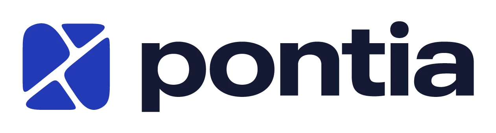

<h3 align="center">Menos planillas, más negocios cerrados.</h3>

  Caso de estudio de producto, diseño e ingeniería: una plataforma inmobiliaria que une la gestión del negocio con una vitrina pública propia.

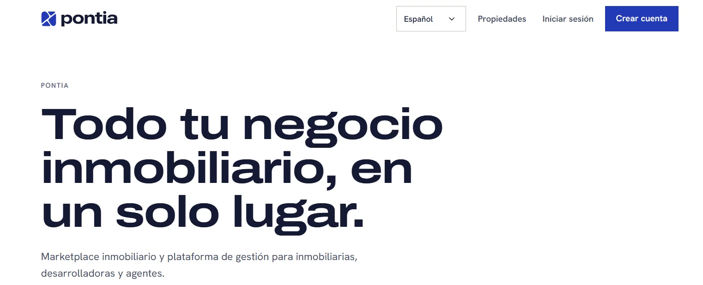

| | |
|---|---|
| **Rol** | Fundadora y responsable de producto: estrategia, alcance, reglas de negocio, marca, sistema de diseño, UX/UI y desarrollo |
| **Plazo** | 2026 hasta hoy |
| **Estado** | En desarrollo. Todavía sin usuarios reales ni lanzamiento (lo digo a propósito) |
| **Mercado** | Paraguay y la región |
| **Plataforma** | Web responsive (escritorio y móvil) |
| **Idiomas** | Español, inglés, alemán y portugués |
| **Monedas** | Guaraníes, dólares, euros, reales y pesos argentinos |
| **Proyecto en línea** | _próximamente_ |

---

## Resumen

En Paraguay, una inmobiliaria trabaja con una planilla para las propiedades, otra para los alquileres, un portal donde publicar y un grupo de WhatsApp para coordinar visitas. El inventario, la gestión y la vidriera pública no son lo mismo, y cada pieza se desactualiza por separado.

**Pontia** junta las tres cosas en un solo producto: un software de gestión para inmobiliarias, desarrolladoras, loteadoras, administradoras y agentes; un marketplace público con página propia por organización; y, más adelante, un portal para inquilinos, propietarios y compradores.

Este documento cuenta cómo pensé el producto, qué decidí y por qué, cómo diseñé el sistema visual y qué cambiaría.

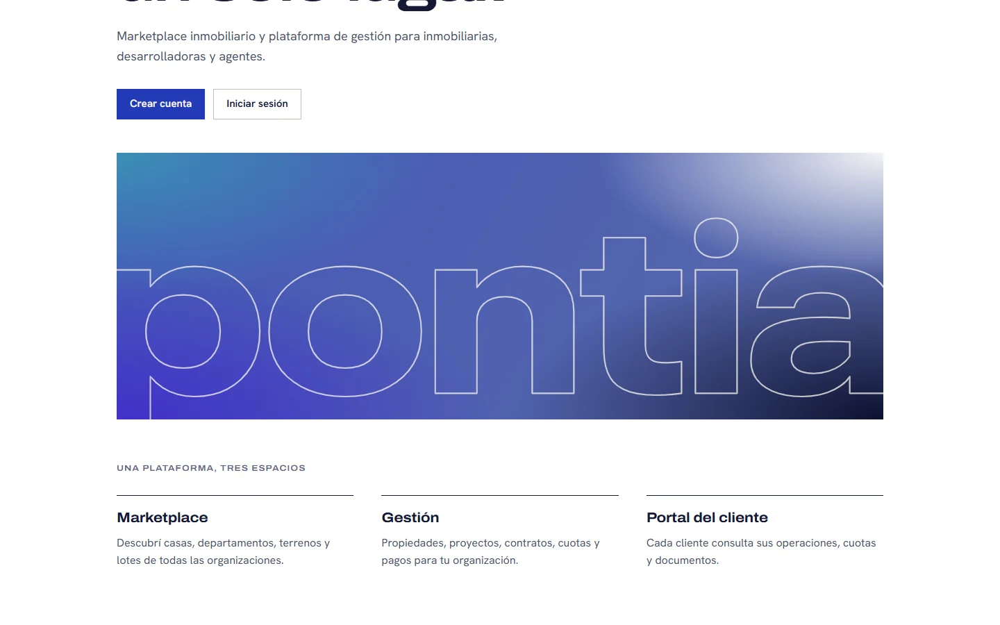

## Contenido

1. [El problema](#1-el-problema)
2. [La propuesta](#2-la-propuesta)
3. [Para quién: seis perfiles](#3-para-quién-seis-perfiles)
4. [Cómo trabajé](#4-cómo-trabajé)
5. [Qué hay adentro](#5-qué-hay-adentro)
6. [Marca](#6-marca)
7. [Sistema de diseño](#7-sistema-de-diseño)
8. [Auditoría de UI/UX y rediseño del panel](#8-auditoría-de-uiux-y-rediseño-del-panel)
9. [Visión técnica](#9-visión-técnica)
10. [Decisiones clave](#10-decisiones-clave)
11. [Estado actual y lo que viene](#11-estado-actual-y-lo-que-viene)
12. [Qué haría distinto](#12-qué-haría-distinto)

---

## 1. El problema

Las inmobiliarias, las desarrolladoras y los agentes independientes no tienen un lugar donde **su inventario, su gestión y su vidriera pública sean lo mismo**. Lo que pasa hoy:

- **Información repartida.** Propiedades en una planilla, alquileres en otra, cuotas de loteamientos en una tercera.
- **Publicar es otro trabajo.** Lo que se carga para gestionar hay que volver a cargarlo en un portal para mostrarlo.
- **La coordinación vive en el chat.** Las visitas se arreglan por WhatsApp, sin registro de quién consultó qué.
- **Cobranza manual.** Cuotas, mora y vencimientos se calculan a mano, y un error de cuenta es un problema con el cliente.

## 2. La propuesta

Tres espacios sobre los mismos datos:

| Espacio | Para quién | Qué resuelve |
|---|---|---|
| **Marketplace** | Quien busca casa, departamento, terreno o lote | Buscador con filtros, fichas con fotos y mapa, página propia de cada organización y pedido de visita con aviso por WhatsApp |
| **Gestión** | El equipo de la organización | Propiedades, loteamientos, alquileres, clientes, cuotas, equipo y permisos en un solo panel |
| **Portal del cliente** _(pendiente)_ | Inquilinos, propietarios y compradores | Consultar sus operaciones, cuotas y documentos |

Lo que se carga una vez para gestionar es lo que se publica: no hay que duplicar nada.

**Alcance deliberado.** Pontia no es un CRM ni un constructor de sitios web. Cada vez que apareció una función que lo empujaba hacia ahí, la dejé registrada como decisión abierta en lugar de sumarla.

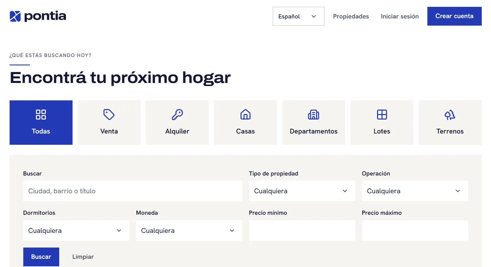

## 3. Para quién: seis perfiles

| Perfil | Qué necesita | Qué puede hacer |
|---|---|---|
| **Administrador de la plataforma** | Ver y ordenar todo el producto | Consola propia: organizaciones, usuarios, niveles de ficha, catálogos, auditoría |
| **Administrador de la organización** | Controlar su negocio y lo que ve el público | Todo dentro de su organización: equipo, roles, datos públicos, auditoría |
| **Usuario administrativo** | El día a día de las propiedades | Cargar, editar, publicar, importar y subir fotos; no toca equipo ni datos de la organización |
| **Agente asociado o independiente** | Atender consultas de cualquier cliente | Ve el catálogo completo, crea borradores y edita y publica solo lo suyo |
| **Cliente** _(pendiente)_ | Saber en qué está su operación | Portal propio, fuera de los roles de la organización |
| **Visitante** | Encontrar una propiedad y consultar | Buscar, ver fichas y pedir una visita sin crear cuenta |

Los permisos son **datos, no código**: cada permiso corresponde a una función real y cada organización recibe una copia editable de los roles. Cambiar el rol de alguien no requiere tocar nada técnico.

Un ejemplo de decisión que tomé con opciones sobre la mesa: _¿qué ve y qué edita un agente?_ Evalué que viera solo lo suyo o todo el catálogo. Elegí que **vea todo** (para atender consultas de cualquier cliente) pero **edite y publique solo lo suyo**, lo que me llevó a un permiso propio (`property.update_own`) y a un selector de responsable en cada propiedad.

## 4. Cómo trabajé

El proyecto lo llevé como producto, no como un conjunto de pantallas:

1. **Especificación primero.** Una especificación del producto como fuente de verdad: alcance, módulos, perfiles, reglas de negocio y requisitos.
2. **Benchmark.** Análisis de competidores de la región para ubicar qué resuelve cada uno y dónde quedan huecos.
3. **Las dudas no se inventan.** Cada pregunta de negocio sin respuesta quedó registrada como **decisión abierta** (con un código, opciones y una recomendación) en lugar de resolverse por suposición. Hay decisiones cerradas, como los permisos por perfil, y otras que siguen abiertas, como los planes comerciales.
4. **Cada tema nuevo, en el mismo ciclo.** Diseño con preguntas de a una → documento de diseño → plan de tareas → ejecución con pruebas primero.
5. **Revisión crítica del diseño.** Una auditoría de UI/UX sobre mi propio trabajo (sección 8), con diagnóstico, fases y decisiones que se aprueban antes de ejecutar.
6. **Documentación como entregable.** Estado del producto, decisiones, sistema de diseño y traspasos entre etapas siempre actualizados, para que cualquier persona pueda retomar el proyecto sin leer una conversación.

## 5. Qué hay adentro

Nueve módulos que el administrador de la plataforma activa por organización:

- **Propiedades.** Alta y edición, estados, publicación, fotos, mapa y carga masiva por CSV, con niveles de ficha gratuita, intermedia y premium.
- **Marketplace.** Ficha pública, buscador con filtros, página de cada organización y solicitud de visita con aviso por WhatsApp.
- **Alquileres.** Contratos mensuales, semanales o diarios, cuotas, pagos, mora configurable, depósito y registro de gastos y arreglos por propiedad.
- **Loteamientos.** Lotes dibujados sobre un mapa satelital, reservas, ventas y cuotas con mora por día de atraso.
- **Clientes, equipo, roles y auditoría.**
- **Agenda de visitas, portal del cliente, finanzas, proyectos y documentos,** en distintas etapas de diseño.

### Pantallas

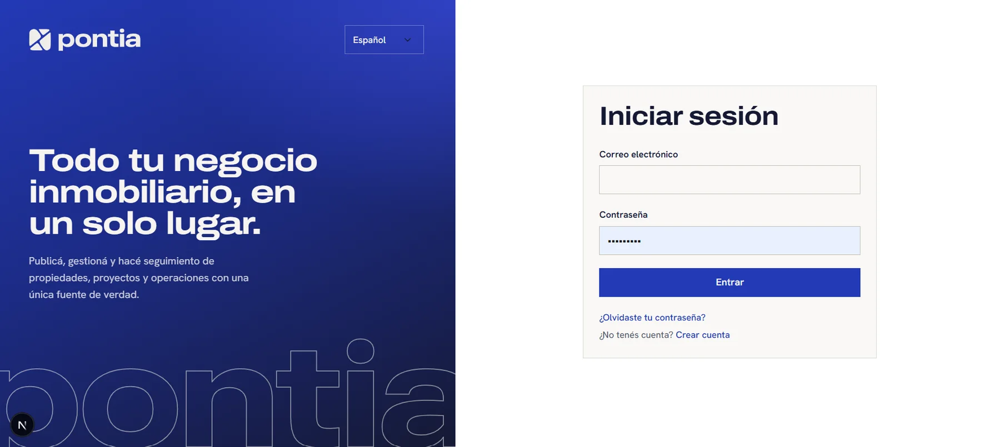

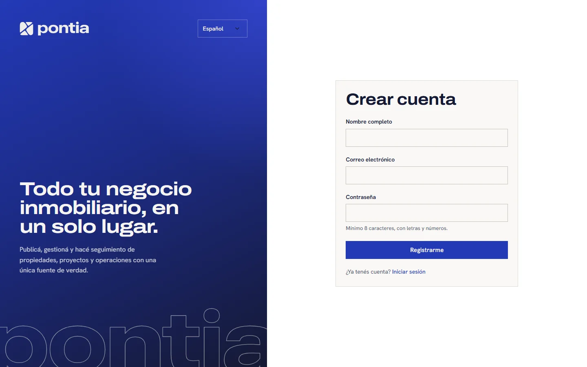

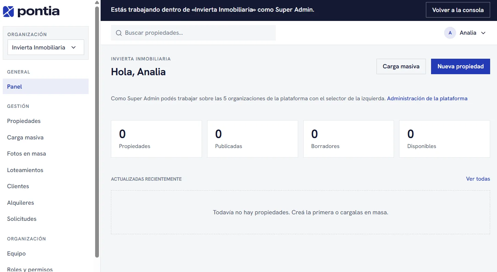

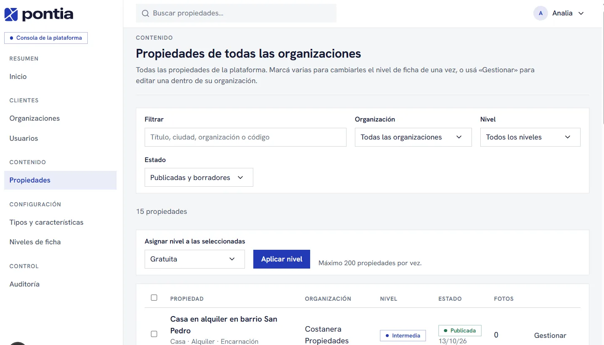

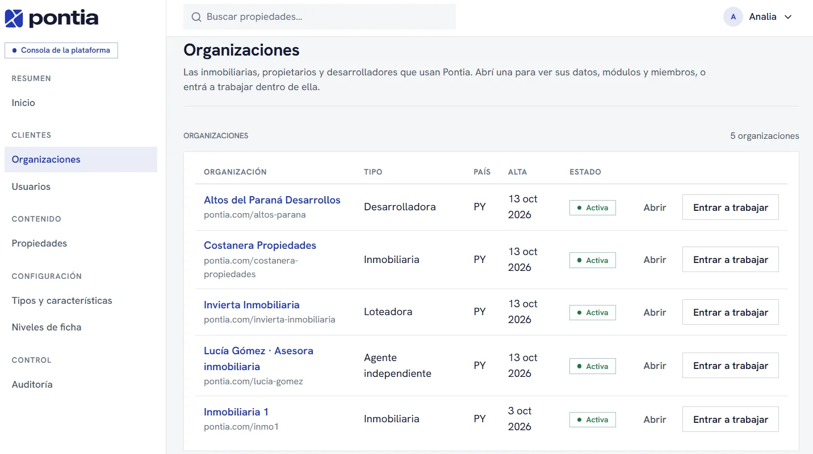

## 6. Marca

Armé la marca junto con el producto: un nombre corto, un isotipo que se lee en tamaños chicos y un logotipo en grotesca ancha que se vuelve el protagonista de las pantallas públicas.

  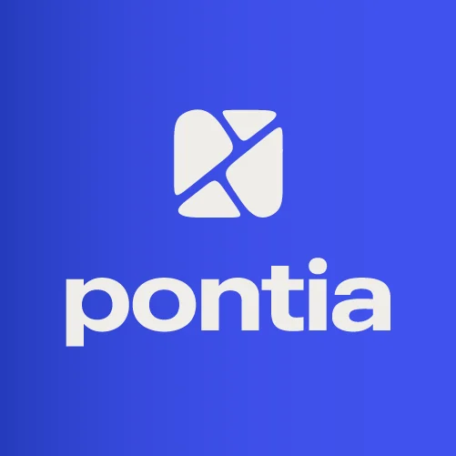
  
  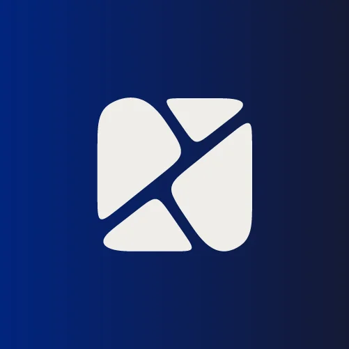

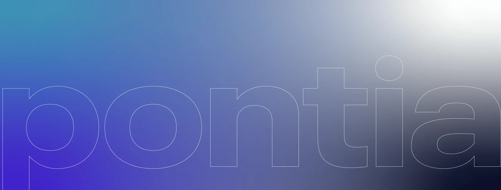

La imagen clave, el nombre en contorno sobre un degradado azul, es el único lugar donde la interfaz usa degradado. En el resto, la marca se apoya en el color plano, la tipografía y el aire.

## 7. Sistema de diseño

**Un solo archivo controla el aspecto de todo el sitio.** Cambiar un color, una tipografía, un radio o el aspecto de los botones allí cambia todas las pantallas a la vez.

### Dirección visual

Sobria, editorial y limpia. Blanco cálido de marca como lienzo, tinta azul noche para el texto y el azul real **solo como acento** (acción principal, enlaces, foco). Líneas finas en lugar de sombras, radios pequeños, mucho aire y titulares en grotesca ancha como el logotipo. Sin degradados salvo la imagen clave, sin emojis ni efectos decorativos.

### Tokens

| Token | Valor | Uso |
|---|---|---|
| Azul de marca | `#2339b7` | Acción principal, enlaces, foco |
| Tinta | `#151933` | Texto y fondos oscuros |
| Lienzo | `#efede9` | Fondo de página (blanco cálido de marca) |
| Papel | `#f9f8f6` | Tarjetas y campos |
| Texto secundario | `#4a4f66` · `#5f647c` | Cuerpo secundario y leyendas (contraste AA) |
| Líneas | `#dcd9d2` · `#c3bfb5` | Líneas finas y bordes de controles |
| Estados | `#1c7448` · `#b0261b` · `#8a5a00` | Éxito, error, advertencia |
| Titulares | Archivo, eje de ancho 125 % | Pantallas públicas |
| Texto | Hanken Grotesk | Todo lo demás |
| Radios | 6 px controles · 10 px tarjetas | |
| Objetivo táctil | 44 px | Alto mínimo de controles |

### Dos temas, un solo sistema

La misma interfaz no sirve para vender y para trabajar. Resolví con **dos temas** que se aplican una sola vez, en el contenedor, sin tocar las pantallas:

| | Público | Panel |
|---|---|---|
| Uso | Inicio, acceso, buscador, ficha, página de organización | Consola de la plataforma y panel de la organización |
| Lienzo | Blanco cálido de marca | Neutro frío `#f5f6f8` con superficies blancas |
| Titulares | Grotesca ancha | Hanken Grotesk, tamaño de producto |
| Controles | 44 px | 36 px en escritorio, 44 px con puntero táctil |
| Objetivo | Que la marca se note | Velocidad y densidad |

### Reglas que se hacen cumplir con una prueba automática

El diseño no depende de la memoria de quien lo toca. Una prueba falla si una pantalla:

- usa colores hexadecimales, la paleta por defecto de Tailwind, colores arbitrarios, sombras, radios o estilos en línea;
- usa una clase que no existe en el sistema de diseño.

El layout (`flex`, `grid`, espaciado) sí va en las pantallas. Un componente nuevo se agrega **al sistema**, no a la pantalla. La única excepción son los colores propios de cada organización en su página pública, que se validan al leerlos: si no alcanzan contraste AA con su texto, se usa el de Pontia.

### Accesibilidad

- Contraste AA en texto y estados.
- Objetivos táctiles de 44 px y foco visible de 2 px.
- Se respeta `prefers-reduced-motion`.
- Páginas públicas renderizadas en el servidor, para SEO y rendimiento.

## 8. Auditoría de UI/UX y rediseño del panel

A mitad del proyecto revisé críticamente mi propio trabajo: el sistema de diseño completo, las pantallas con sesión y las públicas, en escritorio (1440 px) y en móvil (375 px).

**Diagnóstico en una frase:** la interfaz tenía identidad de marca (editorial, cálida, titulares anchos) pero la usaba igual **dentro del panel de trabajo, donde el usuario necesita velocidad y densidad**. Se veía más revista que software.

Ante la pregunta _"¿usaría esto en el dashboard?"_, mi respuesta fue **no**: el titular ancho y pesado funciona donde se vende la marca, no donde se trabaja.

### Hallazgos de la primera fase

| # | Problema | Qué hice |
|---|---|---|
| 1 | **Móvil roto:** el menú lateral se apilaba entero sobre el contenido y los titulares se cortaban | Menú como cajón lateral (botón en la barra superior, velo, cierra con Esc) y titulares que no desbordan |
| 2 | **Escala tipográfica de editorial dentro de la app** | Dos escalas: marca (pública) y producto (panel: títulos de 24 px, cifras de 28 px, texto de 14 px) |
| 3 | **Densidad demasiado holgada** | Controles de 36 px en escritorio y 44 px solo con puntero táctil |
| 4 | **Barra superior casi vacía** | Búsqueda de propiedades y menú de cuenta con avatar, idioma y cerrar sesión |
| 5 | **Listas como pilas de tarjetas, inconsistentes** | Un solo patrón: tabla de datos con acciones por fila |
| 6 | **"Atajos" repetía el menú lateral** | Se eliminó del resumen |
| 7 | **Sin estados de carga ni de error** | Esqueletos de carga por sección y pantalla de error propia con reintento |

Más adelante, en configuración: los niveles de ficha pasaron de una tarjeta con formulario por nivel a una **tabla comparativa**, y la edición se hace en un cuadro de diálogo nativo (foco atrapado, Esc cierra).

### Decisiones que dejé al criterio de quien aprueba

Color del panel (neutro frío o cálido de marca), librería de iconos, alcance de la búsqueda global y referencia visual. Las presenté como preguntas con recomendación, no como hechos.

### Lo que queda por revisar

Las pantallas con sesión las verifiqué con datos de ejemplo montados con las mismas clases reales, **no con una cuenta de usuario real**. Es la primera cosa que quiero cerrar antes de seguir sumando módulos.

## 9. Visión técnica

Diseñé y construí todo el sistema, así que las decisiones técnicas siguen las reglas del producto y no al revés. Esta es la visión general, sin detalle de código.

### Tecnologías

| Capa | Elección |
|---|---|
| Aplicación | Next.js 16, React 19 y TypeScript, como monolito modular |
| Datos | PostgreSQL en Supabase (base de datos, autenticación y almacenamiento de archivos) con Drizzle ORM |
| Interfaz | Tailwind CSS 4 sobre un único archivo de sistema de diseño, y next-intl para cuatro idiomas |
| Mapas | Google Maps para el mapa de loteamientos, Leaflet para el mapa público |
| Validación | Zod |
| Calidad | Vitest con un PostgreSQL en memoria (PGlite), dependency-cruiser y GitHub Actions |
| Hosting | Railway es el destino elegido, todavía sin desplegar |

### Arquitectura

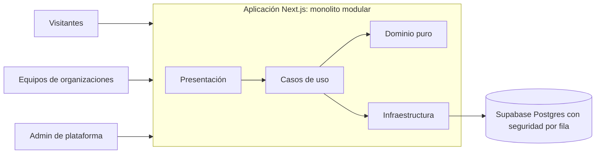

En texto: tres tipos de usuarios llegan a una única aplicación Next.js. Adentro, la presentación llama a casos de uso, los casos de uso se apoyan en un dominio puro y la infraestructura es la única capa que toca la base de datos. La base de datos garantiza por sí misma el aislamiento entre organizaciones.

### Decisiones técnicas

| Decisión | Por qué |
|---|---|
| **Monolito modular, con límites vigilados por una herramienta** | Una sola unidad de despliegue es simple de operar, y una regla de dependencias rompe la compilación si un módulo invade a otro o si el dominio importa un framework |
| **Aislamiento entre organizaciones en dos capas independientes** | El servidor filtra por organización y la base de datos aplica seguridad por fila. Si una capa falla, la otra sigue protegiendo los datos |
| **Los visitantes anónimos nunca leen tablas** | El marketplace público llama a funciones de la base de datos que devuelven datos ya filtrados |
| **Todo lo configurable es dato** | Catálogos, roles, módulos y niveles de ficha los edita el administrador de la plataforma sin publicar una versión |
| **Dinero en unidades menores enteras, con cinco monedas** | Evita errores de redondeo en cuotas y moras |
| **Auditoría de solo agregar y ediciones versionadas** | Cada cambio relevante registra a su autor, y dos personas que editan el mismo registro no se pisan |

### Calidad

Más de 1.100 pruebas automatizadas cubren reglas de base de datos, servicios, seguridad, arquitectura, traducciones y sistema de diseño. Un solo comando (`verify`) ejecuta lint, tipos, reglas de arquitectura, pruebas y verificación de migraciones antes de integrar cualquier cambio.

## 10. Decisiones clave

- **Aislamiento entre organizaciones en dos capas.** Los datos de una organización nunca se ven desde otra: la regla se impone en el servidor y otra vez en la base de datos, con seguridad a nivel de fila.
- **Todo configurable por datos.** Tipos de propiedad, características, estados, roles, módulos y niveles de ficha los edita el administrador sin tocar código. Los niveles se aplican en la base de datos, de modo que un cliente manipulado no puede saltárselos.
- **Multimoneda y multilingüe desde el inicio.** El dinero se guarda siempre en enteros de la unidad menor, para que nunca haya errores de redondeo en cuotas y mora.
- **Mora configurable.** Por día de atraso, definida por organización, por loteamiento o por venta, con período de gracia; se puede cobrar o perdonar aparte de la cuota.
- **Lo que no está definido no se inventa.** Cada duda de negocio queda registrada como decisión abierta.
- **Alcance deliberado.** No es un CRM ni un constructor de sitios web.
- **Un solo sistema de diseño**, en un único archivo, con una prueba automática que impide estilos sueltos.
- **Dirección pública simple:** una por organización, con historial de cambios y redirección permanente.

## 11. Estado actual y lo que viene

**Construido:** los cimientos, el marketplace, la gestión de propiedades, buena parte de alquileres y loteamientos, equipo, roles y auditoría.

**En camino:** gastos y arreglos de alquileres (recién construido), tipos de propiedad con características propias, alquiler por día con horario para quintas y departamentos, y publicación en un entorno de producción.

**Más adelante:** portal del cliente, firma digital de contratos, facturación electrónica, finanzas y proyectos con planes de pago para desarrolladoras.

Es un producto en desarrollo: todavía no tiene usuarios reales ni un entorno de producción, y prefiero decirlo con claridad.

## 12. Qué haría distinto

- **Verificar cada pantalla con una cuenta real antes de seguir sumando módulos.** Fui rápido en construir y más lento en mirar el uso verdadero; la auditoría me lo mostró.
- **Llevar la primera organización a un entorno de pruebas separado en una etapa más temprana.** Tener producción y desarrollo en una sola base hizo más riesgosas las migraciones.

---

## Código

El código del producto está en un repositorio privado. Este repositorio reúne la explicación del proyecto y las imágenes del producto.

© Analia Arguello. Las imágenes y los textos de este repositorio son del proyecto Pontia y no están licenciados para reutilización.
