
<b>English</b> · <a href="README.es.md">Español</a>

  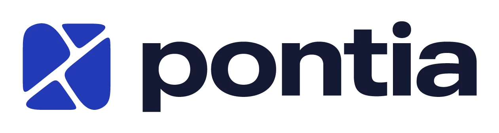

<h3 align="center">Fewer spreadsheets, more closed deals.</h3>

  Product case study: a real estate platform that brings business management and a public storefront into one product.

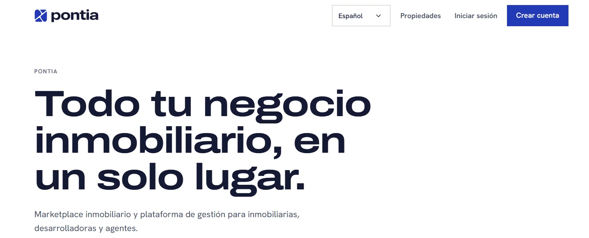

| | |
|---|---|
| **Role** | Founder and product lead: strategy, scope, business rules, brand, design system, UX/UI and development |
| **Timeline** | 2026 to present |
| **Status** | In development. No real users and not launched yet (on purpose, I say so openly) |
| **Market** | Paraguay and the region |
| **Platform** | Responsive web (desktop and mobile) |
| **Languages** | Spanish, English, German and Portuguese |
| **Currencies** | Paraguayan guaraní, US dollar, euro, Brazilian real and Argentine peso |
| **Live project** | _coming soon_ |

---

## Summary

In Paraguay, a real estate agency typically works with one spreadsheet for properties, another for rentals, a portal to publish on, and a WhatsApp group to arrange viewings. Inventory, management and the public storefront are not the same thing, and each piece goes out of date on its own.

**Pontia** puts the three together in one product: management software for agencies, developers, land developers, property managers and agents; a public marketplace with a page for each organization; and, later on, a portal for tenants, owners and buyers.

This document explains how I thought through the product, what I decided and why, how I designed the visual system, and what I would change.

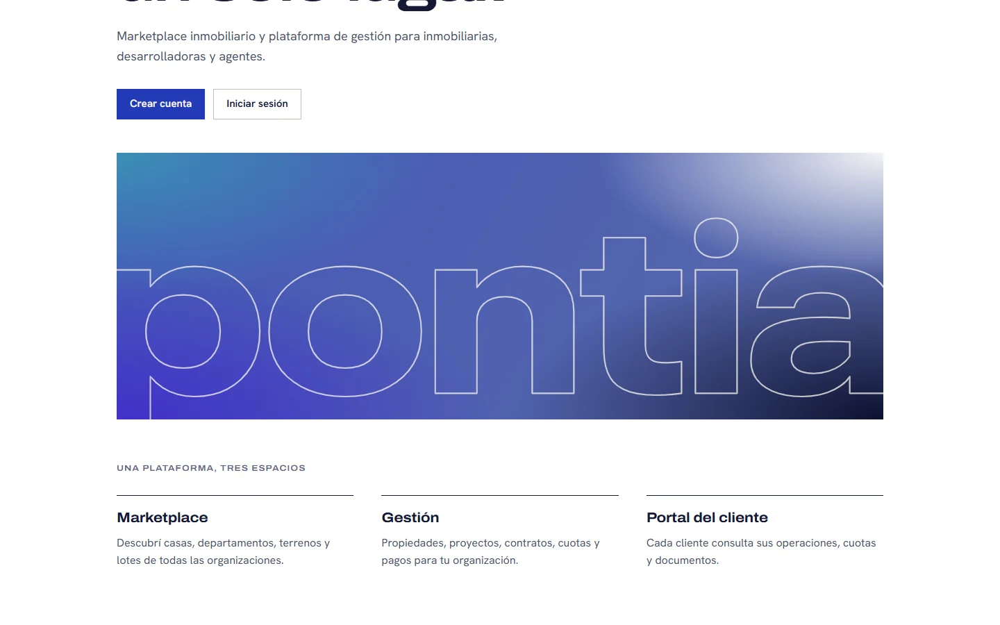

## Contents

1. [The problem](#1-the-problem)
2. [The proposal](#2-the-proposal)
3. [Who it is for: six profiles](#3-who-it-is-for-six-profiles)
4. [How I worked](#4-how-i-worked)
5. [What is inside](#5-what-is-inside)
6. [Brand](#6-brand)
7. [Design system](#7-design-system)
8. [UI/UX audit and panel redesign](#8-uiux-audit-and-panel-redesign)
9. [Key decisions](#9-key-decisions)
10. [Current status and what comes next](#10-current-status-and-what-comes-next)
11. [What I would do differently](#11-what-i-would-do-differently)

---

## 1. The problem

Agencies, developers and independent agents do not have a place where **their inventory, their management and their public storefront are the same thing**. What happens today:

- **Scattered information.** Properties in one spreadsheet, rentals in another, land development installments in a third.
- **Publishing is extra work.** What is entered to manage has to be entered again on a portal to be shown.
- **Coordination lives in chat.** Viewings are arranged over WhatsApp, with no record of who asked about what.
- **Manual collections.** Installments, late fees and due dates are calculated by hand, and a miscalculation becomes a problem with the client.

## 2. The proposal

Three spaces on top of the same data:

| Space | For whom | What it solves |
|---|---|---|
| **Marketplace** | People looking for a house, apartment, plot or lot | Filtered search, listings with photos and a map, each organization's own page, and viewing requests with a WhatsApp notice |
| **Management** | The organization's team | Properties, land developments, rentals, clients, installments, team and permissions in a single panel |
| **Client portal** _(pending)_ | Tenants, owners and buyers | Checking their transactions, installments and documents |

What is entered once to manage is what gets published: nothing has to be duplicated.

**Deliberate scope.** Pontia is not a CRM or a website builder. Every time a feature appeared that pushed it that way, I recorded it as an open decision instead of adding it.

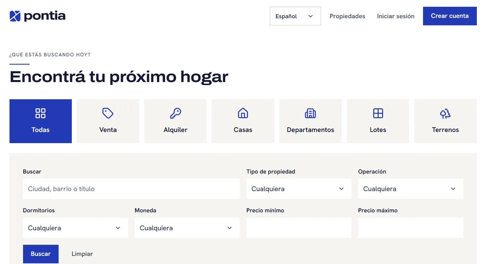

## 3. Who it is for: six profiles

| Profile | What they need | What they can do |
|---|---|---|
| **Platform administrator** | To see and organize the whole product | Own console: organizations, users, listing tiers, catalogs, audit |
| **Organization administrator** | To control their business and what the public sees | Everything inside their organization: team, roles, public data, audit |
| **Administrative user** | The day-to-day of properties | Create, edit, publish, import and upload photos; does not touch the team or organization data |
| **Associate or independent agent** | To handle inquiries about any client | Sees the full catalog, creates drafts, and edits and publishes only their own |
| **Client** _(pending)_ | To know where their transaction stands | Own portal, separate from the organization's roles |
| **Visitor** | To find a property and make an inquiry | Search, view listings and request a viewing without creating an account |

Permissions are **data, not code**: each permission matches a real function, and each organization receives an editable copy of the roles. Changing someone's role does not require touching anything technical.

An example of a decision I made with options on the table: _what can an agent see and edit?_ I weighed letting them see only their own properties against the whole catalog. I chose that they **see everything** (to answer inquiries about any client) but **edit and publish only their own**, which led to a dedicated permission (`property.update_own`) and an owner selector on each property.

## 4. How I worked

I ran the project as a product, not as a set of screens:

1. **Specification first.** A product specification as the source of truth: scope, modules, profiles, business rules and requirements.
2. **Benchmark.** Analysis of competitors in the region to see what each one solves and where the gaps are.
3. **Unknowns are not invented.** Every unanswered business question was recorded as an **open decision** (with a code, options and a recommendation) instead of being settled by assumption. Some decisions are closed, such as permissions by profile, and others remain open, such as commercial plans.
4. **Every new topic goes through the same cycle.** Design through one-at-a-time questions → design document → task plan → execution, tests first.
5. **Critical review of the design.** A UI/UX audit of my own work (section 8), with a diagnosis, phases and decisions that are approved before execution.
6. **Documentation as a deliverable.** Product status, decisions, design system and handoffs between stages kept up to date, so anyone can pick the project up without reading a conversation.

## 5. What is inside

Nine modules that the platform administrator turns on per organization:

- **Properties.** Create and edit, statuses, publishing, photos, map and bulk CSV upload, with free, intermediate and premium listing tiers.
- **Marketplace.** Public listing, filtered search, each organization's page and viewing requests with a WhatsApp notice.
- **Rentals.** Monthly, weekly or daily contracts, installments, payments, configurable late fees, deposit and expense tracking per property.
- **Land developments.** Lots drawn on a satellite map, reservations, sales and installments with late fees per day overdue.
- **Clients, team, roles and audit.**
- **Viewing schedule, client portal, finance, projects and documents,** at different stages of design.

### Screens

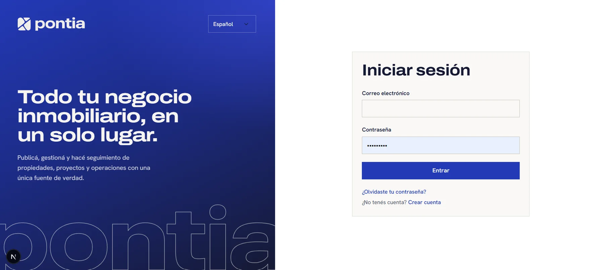

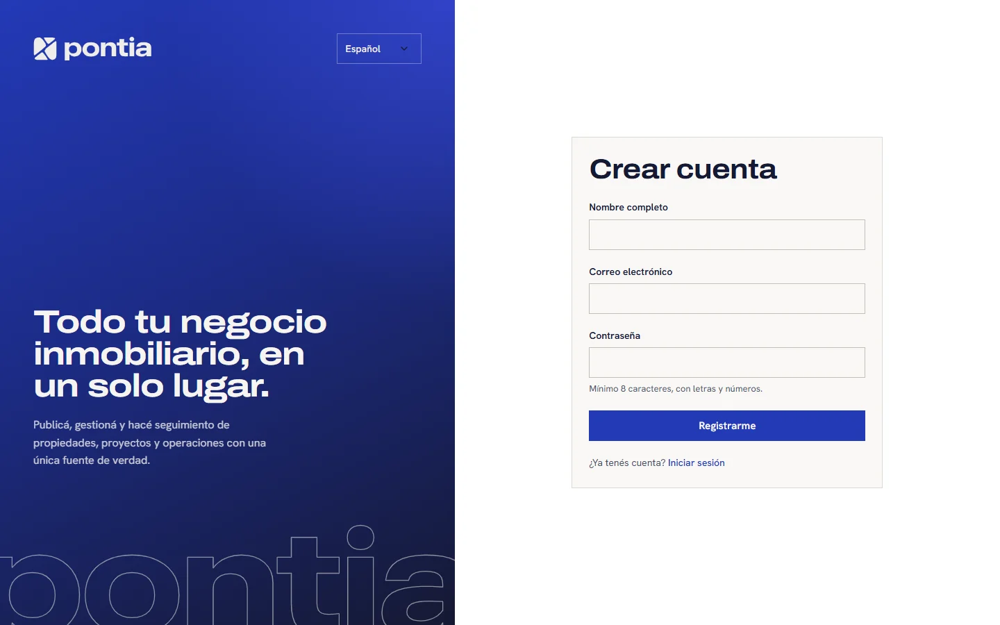

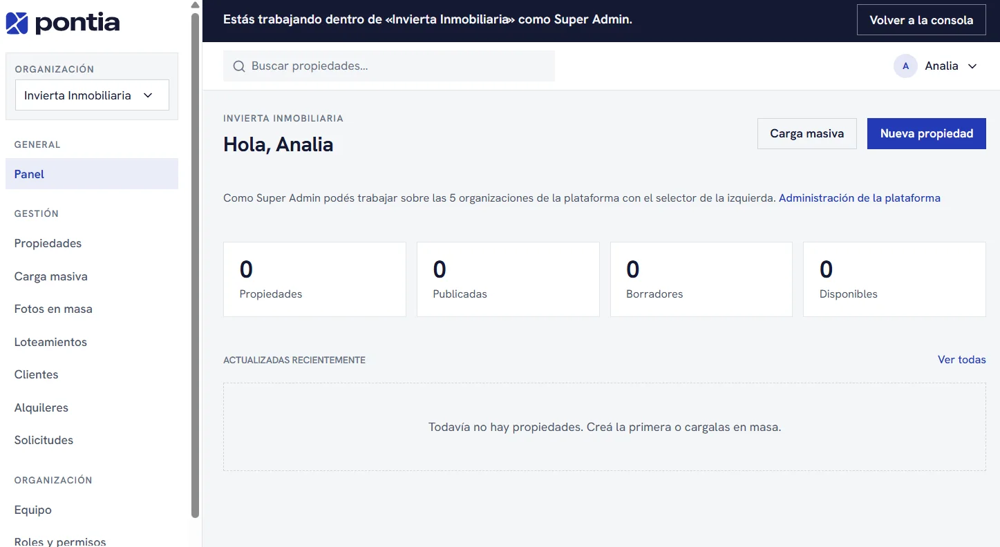

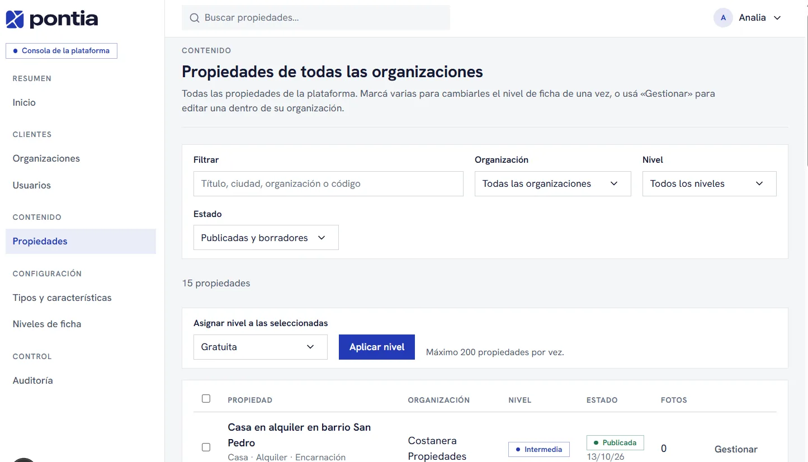

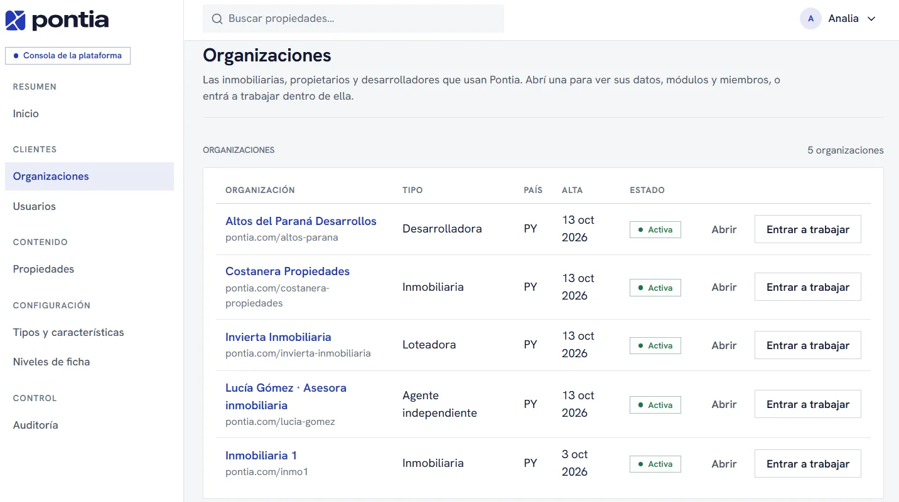

## 6. Brand

I built the brand together with the product: a short name, a symbol that reads at small sizes, and a wide-grotesque logotype that becomes the protagonist of the public screens.

  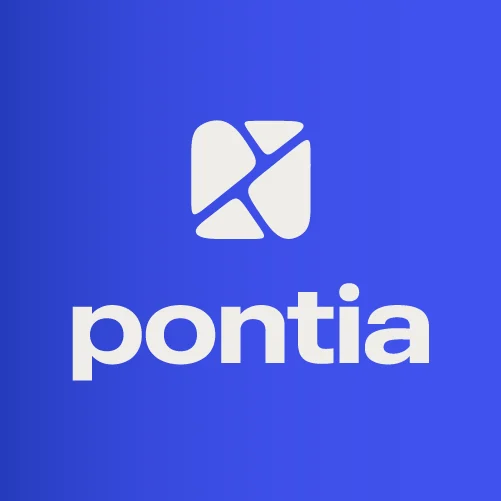
  
  

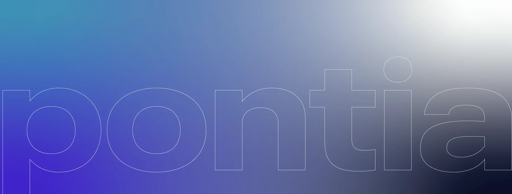

The key visual, the name in outline over a blue gradient, is the only place where the interface uses a gradient. Everywhere else the brand relies on flat color, typography and white space.

## 7. Design system

**A single file controls the look of the entire site.** Changing a color, a typeface, a radius or the look of buttons there changes every screen at once.

### Visual direction

Sober, editorial and clean. A warm brand white as the canvas, midnight-blue ink for text, and the true blue **only as an accent** (primary action, links, focus). Thin lines instead of shadows, small radii, plenty of air, and headlines in a wide grotesque like the logotype. No gradients except the key visual, no emojis, no decorative effects.

### Tokens

| Token | Value | Use |
|---|---|---|
| Brand blue | `#2339b7` | Primary action, links, focus |
| Ink | `#151933` | Text and dark backgrounds |
| Canvas | `#efede9` | Page background (warm brand white) |
| Paper | `#f9f8f6` | Cards and fields |
| Secondary text | `#4a4f66` · `#5f647c` | Secondary body text and captions (AA contrast) |
| Lines | `#dcd9d2` · `#c3bfb5` | Thin lines and control borders |
| States | `#1c7448` · `#b0261b` · `#8a5a00` | Success, error, warning |
| Headlines | Archivo, 125 % width axis | Public screens |
| Text | Hanken Grotesk | Everything else |
| Radii | 6 px controls · 10 px cards | |
| Touch target | 44 px | Minimum control height |

### Two themes, one system

The same interface does not work for selling and for working. I solved it with **two themes** applied once, on the container, without touching the screens:

| | Public | Panel |
|---|---|---|
| Use | Home, sign-in, search, listing, organization page | Platform console and organization panel |
| Canvas | Warm brand white | Cool neutral `#f5f6f8` with white surfaces |
| Headlines | Wide grotesque | Hanken Grotesk, product scale |
| Controls | 44 px | 36 px on desktop, 44 px with a touch pointer |
| Goal | Let the brand show | Speed and density |

### Rules enforced by an automated test

Design does not depend on the memory of whoever touches it. A test fails if a screen:

- uses hexadecimal colors, the default Tailwind palette, arbitrary colors, shadows, radii or inline styles;
- uses a class that does not exist in the design system.

Layout (`flex`, `grid`, spacing) can live in the screens. A new component is added **to the system**, not to the screen. The only exception is each organization's own colors on its public page, which are validated when read: if they do not reach AA contrast with their text, Pontia's are used instead.

### Accessibility

- AA contrast for text and states.
- 44 px touch targets and a visible 2 px focus ring.
- `prefers-reduced-motion` is respected.
- Public pages rendered on the server, for SEO and performance.

## 8. UI/UX audit and panel redesign

Midway through the project I critically reviewed my own work: the whole design system, the signed-in screens and the public ones, on desktop (1440 px) and mobile (375 px).

**Diagnosis in one sentence:** the interface had brand identity (editorial, warm, wide headlines) but used it the same way **inside the work panel, where users need speed and density**. It looked more like a magazine than software.

Asked _"would you use this in the dashboard?"_, my answer was **no**: the wide, heavy headline works where the brand is sold, not where people work.

### First-phase findings

| # | Problem | What I did |
|---|---|---|
| 1 | **Broken mobile:** the side menu stacked entirely above the content and headlines were cut off | Menu as a side drawer (button in the top bar, scrim, closes with Esc) and headlines that no longer overflow |
| 2 | **Editorial type scale inside the app** | Two scales: brand (public) and product (panel: 24 px titles, 28 px figures, 14 px text) |
| 3 | **Density too loose** | 36 px controls on desktop and 44 px only with a touch pointer |
| 4 | **Nearly empty top bar** | Property search and an account menu with avatar, language and sign out |
| 5 | **Lists as piles of cards, inconsistent** | One pattern: data table with per-row actions |
| 6 | **"Shortcuts" repeated the side menu** | Removed from the overview |
| 7 | **No loading or error states** | Loading skeletons per section and a dedicated error screen with retry |

Later, in settings: listing tiers went from one card with a form per tier to a **comparison table**, and editing happens in a native dialog (focus trapped, Esc closes).

### Decisions I left to whoever approves

Panel color (cool neutral or warm brand), icon library, scope of the global search and visual reference. I presented them as questions with a recommendation, not as facts.

### What is still to review

I verified the signed-in screens with sample data built with the same real classes, **not with a real user account**. It is the first thing I want to close before adding more modules.

## 9. Key decisions

- **Isolation between organizations in two layers.** One organization's data is never visible from another: the rule is enforced on the server and again in the database, with row-level security.
- **Everything configurable through data.** Property types, features, statuses, roles, modules and listing tiers are edited by the administrator without touching code. Tiers are enforced in the database, so a tampered client cannot bypass them.
- **Multi-currency and multilingual from the start.** Money is always stored as integers in the minor unit, so there are never rounding errors in installments and late fees.
- **Configurable late fees.** Per day overdue, defined per organization, per land development or per sale, with a grace period; they can be collected or waived separately from the installment.
- **What is not defined is not invented.** Every business doubt is recorded as an open decision.
- **Deliberate scope.** It is not a CRM or a website builder.
- **A single design system**, in one file, with an automated test that prevents stray styles.
- **Simple public address:** one per organization, with change history and a permanent redirect.

## 10. Current status and what comes next

**Built:** the foundations, the marketplace, property management, a good part of rentals and land developments, team, roles and audit.

**On the way:** rental expenses and repairs (just built), property types with their own features, per-day rentals with start and end times for country houses and apartments, and publishing to a production environment.

**Later:** client portal, digital contract signing, electronic invoicing, finance, and projects with payment plans for developers.

It is a product in development: it does not yet have real users or a production environment, and I prefer to say so plainly.

## 11. What I would do differently

- **Verify every screen with a real account before adding more modules.** I was fast at building and slower at looking at real use; the audit showed me that.
- **Move the first organization to a separate test environment earlier.** Having production and development in a single database made migrations riskier.

---

## Code

The product's code lives in a private repository. This repository gathers the project explanation and the product images.

© Analia Arguello. The images and texts in this repository belong to the Pontia project and are not licensed for reuse.
